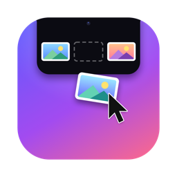

# notchshelf

A shelf that hangs from the MacBook notch. Take a screenshot and it lands there;
switch to whatever app you wanted it in, hover the notch, drag it out. Nothing
piles up in your screenshots folder, and anything on the shelf for a day goes by itself.



## The problem

A screenshot is usually something you use once. macOS's floating thumbnail is
gone after five seconds, finding the app you want to drop it into while
holding a drag is awkward, and every one of them stays behind in a folder you
never clean.

## What it does

- **Screenshots go to the shelf by themselves.** New captures in your
  screenshots folder (wherever ⇧⌘5 → Options → Save to points) are moved onto
  the shelf. Screen recordings too, with a ▶ badge.
- **iOS Simulator screenshots too.** ⌘S in the Simulator saves to the Desktop
  by default; those get picked up as well (📱 badge).
- **A short peek when one lands**, a thumbnail beside the notch, so you know it
  arrived without hovering.
- **Hover the notch to open the shelf.**
  - **Click** a thumbnail to copy it, then ⌘V anywhere.
  - **Drag** it out into Slack, Figma, Xcode, a ticket… it copies, so you can
    drop the same one twice.
  - **⌥-click** copies its path, escaped for a shell: paste it straight into
    Claude Code.
  - **⌘-click** selects several. Drag one of them and they all go.
  - **Space** opens Quick Look. **Esc** closes the shelf. **Delete** removes.
  - **Right-click** for everything else.
- **Blur before sharing.** The checkerboard button (or right-click → Blur Part
  of It…) opens an editor; drag boxes over tokens, emails or customer data,
  then Save. The shelf keeps the pixelated copy.
- **Pin** what you want to keep. Everything else is cleared once it's been on
  the shelf for **24 hours**. The check runs at launch, on wake and every
  minute, so the Mac doesn't need to be awake at any particular time.
- **Drop any file on the notch** to park it there for a day. The original
  stays where it was.
- **⌃⌥⌘V** copies the newest screenshot without opening anything.

Cleared and removed items go to the **Trash**, not oblivion.

The shelf excludes itself from screen capture, so it never shows up in the
screenshots it collects.

## Install

```
./install.sh               # build, install to /Applications, launch
./install.sh --uninstall   # remove (the shelf folder is left alone)
```

Needs Xcode and [XcodeGen](https://github.com/yonaskolb/XcodeGen)
(`brew install xcodegen`).

**One permission prompt:** macOS asks once to let notchshelf access your
Desktop. That's for Simulator screenshots; say no and everything else still
works.

**Tip:** in the menu bar item, turn on **Skip macOS Screenshot Preview**.
While macOS shows its floating thumbnail, it doesn't write the file until the
thumbnail goes away, so screenshots reach the shelf about five seconds late.

## Where things live

| What | Where |
|---|---|
| The shelf's files | `~/Library/Application Support/notchshelf/shelf/` |
| The list of them (pins, dates) | `~/Library/Application Support/notchshelf/shelf.json` |
| Logs | `log stream --predicate 'subsystem == "com.amerabb.notchshelf"' --info` |

## Develop

```
cd ShelfCore && swift test   # the logic: capture detection, sweep, pixelation, geometry
./scripts/build.sh           # builds notchshelf.app here
./scripts/make-icon.sh       # redraws the icon from scripts/make-icon.swift
```

`ShelfCore/` holds everything testable without a window; `App/` is the notch
panel, SwiftUI views and menu bar item.

To check the UI without hovering, render the panel to an image:

```
./notchshelf.app/Contents/MacOS/notchshelf -demoMode expanded -snapshotPath /tmp/shelf.png
```

(`-demoMode peek` for the peek.)

## Releasing

Releases work like Dictation's: push a `v*` tag and GitHub Actions builds the
app, signs a [Sparkle](https://sparkle-project.org) appcast, and publishes the
release. Installed copies check for updates once a day (menu → Check for
Updates…).

### One-time setup (done; kept for reference, e.g. a new machine)

1. **Make a signing key for updates**, separate from Dictation's:

   ```
   mkdir -p /tmp/sparkle
   curl -sL https://github.com/sparkle-project/Sparkle/releases/download/2.9.0/Sparkle-2.9.0.tar.xz | tar xJ -C /tmp/sparkle
   /tmp/sparkle/bin/generate_keys --account notchshelf
   ```

   It stores the private key in your login keychain and prints the public key.
   Put that in `project.yml` → `SUPublicEDKey`.

2. **Create the repo and push.**

   ```
   gh repo create AmerAbb/notchshelf --public --source . --push
   ```

3. **Give CI the private key.**

   ```
   /tmp/sparkle/bin/generate_keys --account notchshelf -x /tmp/notchshelf-key
   gh secret set SPARKLE_PRIVATE_KEY < /tmp/notchshelf-key && rm /tmp/notchshelf-key
   ```

### Each release

```
fastlane release bump:patch   # or minor / major
```

This bumps the version in `project.yml`, commits, tags and pushes.

Release builds are signed ad-hoc (as Dictation's are), so the first launch of
a downloaded copy needs right-click → Open, and macOS asks about the Desktop
again after each update.

## Ideas for later

Gathered from a look at other notch apps (boring.notch, NotchDrop, NotchNook,
Perch, Dropover):

- Drop actions inside the shelf: drop a screenshot on "resize for App Store",
  "copy as Markdown image", or an upload target.
- Show the shelf on whichever display the pointer is on, as a small tab where
  there's no notch.
- Simulator helpers: drop a URL to `simctl openurl` (deeplink testing), drop a
  `.app` to install it, toggle a recording.
- Claude Code status in the notch: "waiting for you" / "done", via hooks.
- Xcode build progress and result.
- Configurable sweep (1 hour / 1 day / 1 week).
